# GitAtlas: The Complete Git Knowledge Base


**Learn Git. Understand every change. Debug with confidence. Explore the internals.**

GitAtlas is an open-source documentation project that explains Git from the fundamentals to advanced repository internals. It combines command explanations, runnable examples, visual diagrams, command comparisons, troubleshooting guides, security practices, historical references, and verified research in one organized knowledge base.

The goal is not simply to collect commands. It is to explain **how Git works**, **why similar commands behave differently**, **what happens when something goes wrong**, and **how to recover safely**.

---

## Document Information

| Property | Value |
|---|---|
| **Project** | GitAtlas |
| **Document type** | Technical documentation and learning guide |
| **Status** | In development |
| **Audience** | Beginners, experienced developers, testers, DevOps engineers, students, researchers, open-source contributors |
| **Prerequisites** | A terminal, Git installed, and a text editor |
| **Format** | Markdown with Mermaid diagrams and ASCII figures |
| **Recommended viewer** | GitHub, GitLab, VS Code (Markdown Preview Mermaid Support), or any Mermaid-aware renderer |

> [!NOTE]
> Mermaid diagrams render automatically on GitHub. In editors that do not support Mermaid, the diagram appears as a code block, and the accompanying text explanation still describes the figure.

---

## Table of Contents

1. [Introduction](#1-introduction)
2. [Conventions Used in This Document](#2-conventions-used-in-this-document)
3. [Git Fundamentals](#3-git-fundamentals)
4. [Command Reference](#4-command-reference)
5. [Command Comparisons](#5-command-comparisons)
6. [Git Internals](#6-git-internals)
7. [Troubleshooting](#7-troubleshooting)
8. [Development Lessons Learned](#8-development-lessons-learned)
9. [Security and Safe Recovery](#9-security-and-safe-recovery)
10. [Research and Publications](#10-research-and-publications)
11. [Git History and Contributors](#11-git-history-and-contributors)
12. [Practical Exercises](#12-practical-exercises)
13. [Documentation Standards](#13-documentation-standards)
14. [Project Structure](#14-project-structure)
15. [Technology and Tools](#15-technology-and-tools)
16. [Getting Started and Contributing](#16-getting-started-and-contributing)
17. [Roadmap](#17-roadmap)
18. [License](#18-license)
19. [References](#19-references)
20. [Appendix A: Quick Reference](#appendix-a-quick-reference)
21. [Appendix B: Glossary](#appendix-b-glossary)

### List of Figures

| Figure | Title | Section |
|---|---|---|
| 1 | The three areas of a Git repository | [3.2](#32-the-three-areas) |
| 2 | File lifecycle states | [3.3](#33-file-lifecycle) |
| 3 | Commit history and branch pointers | [3.7](#37-branches-and-head) |
| 4 | `git fetch` vs `git pull` | [5.1](#51-git-fetch-vs-git-pull) |
| 5 | Fast-forward merge | [5.2](#52-git-merge-vs-git-rebase) |
| 6 | Three-way merge | [5.2](#52-git-merge-vs-git-rebase) |
| 7 | Rebase and rewritten commit identities | [5.2](#52-git-merge-vs-git-rebase) |
| 8 | Reset modes | [5.3](#53-git-reset-vs-git-revert) |
| 9 | Revert creates a new commit | [5.3](#53-git-reset-vs-git-revert) |
| 10 | Git object model | [6.2](#62-the-four-object-types) |
| 11 | Reference chain: HEAD to commit | [6.4](#64-references-and-head) |
| 12 | Reflog-based recovery | [7.3](#73-case-3-recovering-a-deleted-branch) |
| 13 | Merge conflict resolution workflow | [7.4](#74-case-4-resolving-a-merge-conflict) |

---

## 1. Introduction

### 1.1 Project Vision

Git is one of the most widely used version control systems in software development, yet many developers learn commands without understanding their underlying behavior.

GitAtlas answers questions such as:

- Why can `git reset` be dangerous?
- What is the actual difference between `git fetch` and `git pull`?
- Why does rebasing change commit identities?
- What happens when a branch is deleted?
- How can previously committed work be recovered?
- What does Git store inside the `.git` directory?
- Why does a merge conflict happen?
- How can a developer investigate a regression introduced several commits ago?
- How should a team recover when a secret has been committed to a repository?

Each answer is supported by accurate explanations, reproducible examples, diagrams, and references.

### 1.2 Mission

Create a comprehensive, practical, and trustworthy learning resource for Git that serves beginners, experienced developers, software testers, DevOps engineers, students, researchers, and open-source contributors.

### 1.3 Core Principles

| # | Principle | What it means in practice |
|---|---|---|
| 1 | Accuracy over quantity | A smaller number of verified pages is better than many unverified ones |
| 2 | Practical examples | Every command is shown with context and expected output |
| 3 | Original explanations | Content is written independently rather than copied from other documentation |
| 4 | Visual understanding | Diagrams accompany technical depth |
| 5 | Safe recovery | Destructive operations are always explained before they are recommended |
| 6 | Verifiable sources | References are checked before they are published |
| 7 | Clear distinctions | Facts, examples, and recommendations are labeled separately |
| 8 | Community improvement | Anyone can review, correct, and extend the material |

### 1.4 Why GitAtlas?

Existing Git resources are valuable, but different learners need different ways to understand the same subject. GitAtlas combines several learning approaches.

| Learning need | GitAtlas approach |
|---|---|
| Learning Git for the first time | Step-by-step beginner tutorials |
| Looking up a command | Structured command reference |
| Understanding confusing commands | Side-by-side comparisons |
| Understanding repository history | Commit graph diagrams |
| Debugging errors | Root causes, diagnostic steps, and recovery options |
| Understanding Git internals | Object model and repository architecture |
| Learning professional workflows | Real-world scenarios |
| Exploring Git's history | Historical sources and contributor references |
| Studying software engineering | Research papers and publications |
| Practicing Git | Exercises and reproducible examples |

### 1.5 Core Features

1. **Complete command documentation:** syntax, options, behavior, examples, and related concepts.
2. **Option-by-option explanations:** what each flag changes, when it is useful, and what risk it introduces.
3. **Comment-by-comment examples:** every code sample explains its instructions.
4. **Real-world scenarios:** feature development, bug fixes, releases, collaboration, and recovery.
5. **Visual explanations:** diagrams for branching, merging, rebasing, remotes, and the object model.
6. **Troubleshooting knowledge base:** errors, diagnostics, root causes, solutions, and lessons learned. Confirmed fixes are clearly separated from suspected causes.
7. **Research and historical references:** a verified bibliography.
8. **Security-first guidance:** risks of destructive commands, exposed credentials, force pushes, and history rewriting.

---

## 2. Conventions Used in This Document

### 2.1 Callout Types

> [!NOTE]
> Additional information that helps understanding.

> [!TIP]
> A recommended practice or shortcut.

> [!IMPORTANT]
> Information required to avoid a common mistake.

> [!WARNING]
> An operation that can lose data, rewrite history, or expose information.

### 2.2 Code Blocks and Comments

Code examples use the following conventions.

| Element | Convention |
|---|---|
| Shell commands | Shown in `bash` blocks |
| Shell comments | Lines beginning with `#` explain the command that follows |
| Expected output | Shown in `text` blocks, labeled "Expected output" |
| Placeholders | Written in angle brackets, such as `<commit-hash>` |
| Illustrative hashes | Commit hashes in examples are examples only; yours will differ |

```bash
# Display the installed Git version
git --version

# Initialize a repository in the current directory
git init

# Show the current working tree status
git status
```

> [!NOTE]
> Shell comments (`#`) are not part of Git. They are ignored by the shell. Commit messages, `.gitignore` comments, and source-code comments are different things and are documented where they appear.

### 2.3 Environment Assumptions

Unless stated otherwise, examples assume:

- Git 2.28 or newer (needed for `git init -b`).
- A Unix-style shell such as Bash or Zsh. On Windows, use Git Bash or WSL for identical results.
- A configured identity (see [3.4](#34-installing-and-configuring-git)).
- The default branch is named `main`. Older installations may use `master`.

---

## 3. Git Fundamentals

### 3.1 What Is Version Control?

Version control records changes to files over time so that you can recall earlier versions, compare changes, collaborate, and understand who changed what and why.

| Type | Description | Examples |
|---|---|---|
| Local | History stored on one machine | RCS |
| Centralized | One central server holds the history | Subversion, Perforce |
| **Distributed** | Every clone holds the full history | **Git**, Mercurial |

Because Git is distributed, nearly every operation (committing, branching, viewing history) works offline, and every clone is a complete backup of the project's history.

> [!NOTE]
> **Git** is the version control tool. **GitHub**, GitLab, and Bitbucket are hosting services built around Git repositories. Git works without any of them.

### 3.2 The Three Areas

Understanding where your changes live is the single most important Git concept.

| Area | Also called | Contains |
|---|---|---|
| Working tree | Working directory | The files you edit |
| Staging area | Index | A snapshot of what will go into the next commit |
| Repository | `.git` directory | The permanent history of commits |

**Figure 1: The three areas of a Git repository**

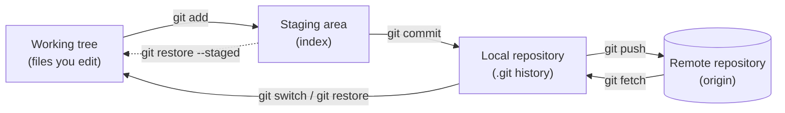

*Figure 1 shows how changes move between areas. Edits begin in the working tree, are selected with `git add`, are recorded with `git commit`, and are shared with `git push`.*

### 3.3 File Lifecycle

Every file in a repository is in one of four states.

**Figure 2: File lifecycle states**

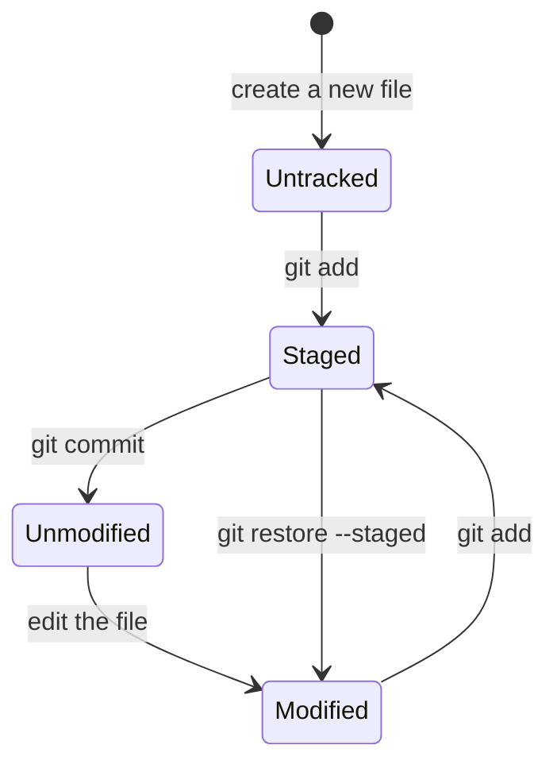

| State | Meaning |
|---|---|
| Untracked | Git does not know about the file yet |
| Unmodified | The file matches the latest commit |
| Modified | The file changed but is not staged |
| Staged | The change is queued for the next commit |

### 3.4 Installing and Configuring Git

#### Installation

| Platform | Typical method |
|---|---|
| Windows | Installer from [git-scm.com](https://git-scm.com/), which includes Git Bash |
| macOS | `xcode-select --install`, or `brew install git` |
| Debian/Ubuntu | `sudo apt install git` |
| Fedora | `sudo dnf install git` |

```bash
# Verify the installation
git --version
```

Expected output (your version number may differ):

```text
git version 2.43.0
```

#### Configuring Your Identity

Every commit records an author name and email address.

```bash
# Set the name stored in your commits
git config --global user.name "Your Name"

# Set the email stored in your commits
git config --global user.email "you@example.com"

# Choose the default branch name for new repositories
git config --global init.defaultBranch main

# Review all configuration values and where they come from
git config --list --show-origin
```

| Scope | Flag | Stored in |
|---|---|---|
| System | `--system` | All users on the machine |
| Global | `--global` | Your user account (`~/.gitconfig`) |
| Local | `--local` (default) | The current repository (`.git/config`) |

More specific scopes override broader ones.

### 3.5 Your First Repository

**Prerequisites:** Git installed and an identity configured.

```bash
# Check whether Git is installed
git --version

# Create a project directory
mkdir git-atlas-demo

# Enter the project directory
cd git-atlas-demo

# Initialize the repository
git init

# Create a sample file
echo "Learning Git with GitAtlas" > README.md

# Inspect the repository state
git status

# Stage the file
git add README.md

# Create the first commit
git commit -m "Add initial README"

# Inspect the commit history
git log --oneline
```

Expected output of the key steps:

```text
$ git init
Initialized empty Git repository in /home/you/git-atlas-demo/.git/

$ git status
On branch main

No commits yet

Untracked files:
  (use "git add <file>..." to include in what will be committed)
	README.md

nothing added to commit but untracked files present (use "git add" to track)

$ git commit -m "Add initial README"
[main (root-commit) 3f2a9c1] Add initial README
 1 file changed, 1 insertion(+)
 create mode 100644 README.md

$ git log --oneline
3f2a9c1 (HEAD -> main) Add initial README
```

> [!NOTE]
> **Operating system differences:** In older versions of Windows PowerShell, the `>` redirection operator may write files in UTF-16 encoding. Use Git Bash, or an editor, to create text files if you see unexpected characters.

### 3.6 Making and Inspecting Commits

```bash
# Modify the file
echo "A second line" >> README.md

# See unstaged changes (working tree vs. index)
git diff

# Stage the change
git add README.md

# See staged changes (index vs. last commit)
git diff --staged

# Commit with a descriptive message
git commit -m "Add second line to README"

# View history with the graph, one line per commit
git log --oneline --graph --decorate
```

Expected output of `git diff`:

```diff
diff --git a/README.md b/README.md
index 8b1c2d3..4e5f6a7 100644
--- a/README.md
+++ b/README.md
@@ -1 +1,2 @@
 Learning Git with GitAtlas
+A second line
```

#### Writing Good Commit Messages

| Guideline | Example |
|---|---|
| Use a short summary line (about 50 characters) | `Fix login redirect loop` |
| Use the imperative mood | `Add`, `Fix`, `Remove` |
| Explain *why* in the body when needed | Leave a blank line, then explain the reason |
| Keep one logical change per commit | Do not mix unrelated fixes |

### 3.7 Branches and HEAD

A **branch** is a movable pointer to a commit. **HEAD** is a pointer to the branch (or commit) you currently have checked out.

```bash
# Create and switch to a new branch
git switch -c feature/login

# List local branches (* marks the current branch)
git branch

# Switch back to main
git switch main
```

**Figure 3: Commit history and branch pointers**

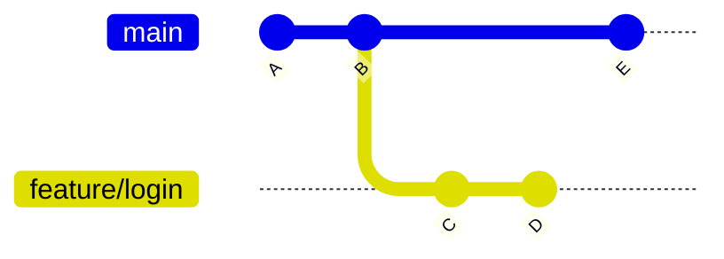

*Figure 3 shows `main` and `feature/login` diverging after commit B. Each circle is a commit; each commit records its parent. Branches are only labels pointing to a commit.*

### 3.8 Ignoring Files with `.gitignore`

A `.gitignore` file lists patterns for files Git should not track, such as build output, dependencies, and secrets.

```gitignore
# Dependencies
node_modules/

# Build output
dist/
build/

# Environment files that may contain secrets
.env
.env.*

# Operating system files
.DS_Store
Thumbs.db

# Logs
*.log
```

> [!WARNING]
> `.gitignore` only affects **untracked** files. If a file was already committed, adding it to `.gitignore` does not remove it from history. Remove it from tracking with `git rm --cached <file>`, and if it contained a secret, follow [9.3](#93-playbook-a-secret-was-committed).

`.gitattributes` is a separate file that controls per-path behavior such as line endings, diff drivers, and binary handling.

```gitattributes
# Normalize line endings for text files
* text=auto

# Treat these as binary
*.png binary
*.pdf binary
```

### 3.9 Remote Repositories

```bash
# Copy an existing repository (full history) to your machine
git clone https://github.com/OWNER/REPOSITORY.git

# List configured remotes with their URLs
git remote -v

# Add a remote to an existing local repository
git remote add origin https://github.com/OWNER/REPOSITORY.git

# Upload your branch and set its upstream
git push -u origin main
```

**Remote-tracking branches** such as `origin/main` are local read-only bookmarks showing where the remote branch was at your last `git fetch`.

### 3.10 Tags and Releases

```bash
# Create a lightweight tag
git tag v1.0.0

# Create an annotated tag (recommended for releases)
git tag -a v1.0.0 -m "First stable release"

# Publish a tag
git push origin v1.0.0
```

| Tag type | Stores | Use for |
|---|---|---|
| Lightweight | Just a name pointing to a commit | Temporary or private markers |
| Annotated | Tagger, date, message (a full object) | Releases |

---

## 4. Command Reference

GitAtlas covers the Git command set progressively. The inventory is maintained against the official Git documentation rather than a fixed list of popular commands.

> [!NOTE]
> This is an initial selection, not an exhaustive list.

### 4.1 Basic Commands

| Command | Purpose |
|---|---|
| `git init` | Create a new repository |
| `git clone` | Copy an existing repository |
| `git status` | Show the state of the working tree and index |
| `git add` | Stage changes for the next commit |
| `git commit` | Record staged changes as a commit |
| `git log` | Show commit history |
| `git show` | Display a commit, tag, or other object |
| `git diff` | Compare commits, the index, and the working tree |

### 4.2 Branching and Integration

| Command | Purpose |
|---|---|
| `git branch` | List, create, rename, or delete branches |
| `git switch` | Switch branches |
| `git checkout` | Switch branches or restore files (older, multi-purpose command) |
| `git merge` | Join two histories |
| `git rebase` | Reapply commits on top of another base |
| `git cherry-pick` | Apply the change from a specific commit |
| `git worktree` | Check out multiple branches in separate directories |

### 4.3 Undoing and Recovering Changes

| Command | Purpose |
|---|---|
| `git restore` | Restore files in the working tree or index |
| `git reset` | Move the current branch pointer, optionally changing the index and working tree |
| `git revert` | Create a new commit that undoes an earlier commit |
| `git stash` | Temporarily shelve uncommitted changes |
| `git reflog` | Show the history of where references have pointed |
| `git clean` | Remove untracked files |

### 4.4 Remote Repositories

| Command | Purpose |
|---|---|
| `git remote` | Manage remote connections |
| `git fetch` | Download remote data without integrating it |
| `git pull` | Fetch, then integrate |
| `git push` | Upload local commits |
| `git ls-remote` | List references in a remote repository |
| `git bundle` | Package a repository or its history into a single file |

### 4.5 History and Investigation

| Command | Purpose |
|---|---|
| `git blame` | Show who last modified each line |
| `git bisect` | Binary-search history to find the commit that introduced a bug |
| `git grep` | Search tracked files |
| `git shortlog` | Summarize commits by author |
| `git describe` | Name a commit relative to the nearest tag |
| `git log -p` | Show history together with the patches |

### 4.6 Advanced Commands and Internals

| Command | Purpose |
|---|---|
| `git cat-file` | Inspect an object's type, size, or contents |
| `git hash-object` | Compute (and optionally store) an object ID |
| `git ls-tree` | List the contents of a tree object |
| `git ls-files` | List files in the index and working tree |
| `git rev-parse` | Resolve names to object IDs and query repository paths |
| `git show-ref` | List references and their commit IDs |
| `git update-ref` | Safely update a reference |
| `git fsck` | Verify the integrity of the object database |
| `git gc` | Clean up and optimize the repository |
| `git count-objects` | Report object database size |
| `git pack-objects` | Create packed archives of objects |

### 4.7 Standard Command Page

Every command in GitAtlas follows this template.

| # | Section |
|---|---|
| 1 | Command name |
| 2 | Purpose |
| 3 | Syntax |
| 4 | Explanation of important options |
| 5 | Prerequisites |
| 6 | Basic examples |
| 7 | Advanced examples |
| 8 | Expected output |
| 9 | Common mistakes |
| 10 | Error messages and troubleshooting |
| 11 | Security implications |
| 12 | Related commands |
| 13 | Practical exercises |
| 14 | Official references |
| 15 | Version-specific behavior |

### 4.8 Sample Command Page: `git reset`

#### Purpose

Move the current branch to a different commit and, depending on the mode, update the staging area and working tree to match.

#### Syntax

```bash
git reset [--soft | --mixed | --hard] [<commit>]
git reset [<commit>] -- <path>...
```

#### Options Explained

| Option | Moves branch | Resets index | Resets working tree | Risk |
|---|:---:|:---:|:---:|---|
| `--soft` | Yes | No | No | Low. Changes remain staged |
| `--mixed` (default) | Yes | Yes | No | Low. Changes remain in files but are unstaged |
| `--hard` | Yes | Yes | **Yes** | **High. Uncommitted work is discarded** |

#### Examples

```bash
# Undo the last commit but keep its changes staged
git reset --soft HEAD~1

# Undo the last commit and unstage its changes (default mode)
git reset HEAD~1

# Discard the last commit AND all uncommitted changes (destructive)
git reset --hard HEAD~1
```

Expected output of `git reset --hard HEAD~1`:

```text
HEAD is now at 9b8a7c6 Add second line to README
```

#### Common Mistakes

- Running `--hard` with uncommitted work in the tree. Those changes are not recorded anywhere and generally cannot be recovered.
- Resetting a branch that others have already pulled, then force-pushing.

#### Security and Safety Implications

> [!WARNING]
> `git reset --hard` can permanently discard uncommitted work. Run `git status` first. Commits discarded by a reset can often be recovered through the reflog (see [7.3](#73-case-3-recovering-a-deleted-branch)), but uncommitted changes cannot.

#### Related Commands

`git revert`, `git restore`, `git reflog`, `git stash`

---

## 5. Command Comparisons

GitAtlas explains commands that are frequently confused.

| Comparison | Main learning objective |
|---|---|
| [`git fetch` vs `git pull`](#51-git-fetch-vs-git-pull) | Downloading remote changes versus integrating them |
| [`git merge` vs `git rebase`](#52-git-merge-vs-git-rebase) | Alternative history integration strategies |
| [`git reset` vs `git revert`](#53-git-reset-vs-git-revert) | Moving a reference versus adding a reversal commit |
| [`git restore` vs `git checkout`](#54-other-comparisons) | File restoration versus legacy multi-purpose behavior |
| [`git switch` vs `git checkout`](#54-other-comparisons) | Dedicated branch switching |
| [`git stash` vs `git commit`](#54-other-comparisons) | Temporary storage versus recorded history |
| [`git clone` vs `git init`](#54-other-comparisons) | Copying a repository versus creating one |
| [`git diff` vs `git log -p`](#54-other-comparisons) | Comparing states versus inspecting historical changes |

### 5.1 `git fetch` vs `git pull`

| | `git fetch` | `git pull` |
|---|---|---|
| Downloads new commits | Yes | Yes |
| Updates `origin/main` | Yes | Yes |
| Changes your local branch | **No** | **Yes** |
| Changes your working tree | **No** | **Yes** |
| Can cause merge conflicts | No | Yes |
| Equivalent to | n/a | `git fetch` followed by `git merge` (or `git rebase`, if configured) |

**Figure 4: `git fetch` vs `git pull`**

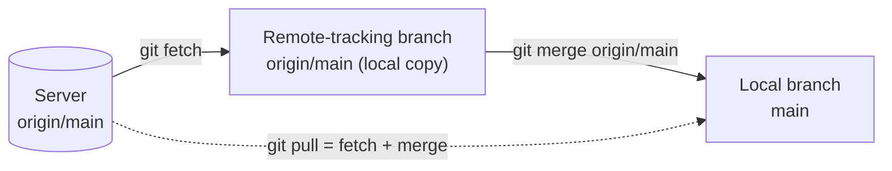

```bash
# Download new remote data without touching your branch
git fetch origin

# See what arrived: commits on origin/main that main does not have
git log --oneline main..origin/main

# Review the changes, then integrate deliberately
git merge origin/main
```

> [!TIP]
> Running `git fetch` first and reviewing before integrating is a safe habit. To make `git pull` refuse anything but a fast-forward, use `git pull --ff-only`.

### 5.2 `git merge` vs `git rebase`

Both integrate changes from one branch into another, but they produce different histories.

| | `git merge` | `git rebase` |
|---|---|---|
| Preserves original commits | Yes | No, commits are recreated |
| Creates a merge commit | Usually (unless fast-forward) | No |
| History shape | Shows true branching | Linear |
| Safe on shared branches | Yes | **No** |
| Typical use | Integrating finished work | Tidying a private branch before sharing |

#### Fast-forward merge

If `main` has not moved since the feature branch was created, Git simply moves the `main` pointer forward.

**Figure 5: Fast-forward merge**

```text
Before:
  A ── B              (main)
        \
         C ── D       (feature)

After `git switch main && git merge feature`:
  A ── B ── C ── D    (main, feature)
```

#### Three-way merge

If both branches have new commits, Git creates a merge commit with two parents.

**Figure 6: Three-way merge**

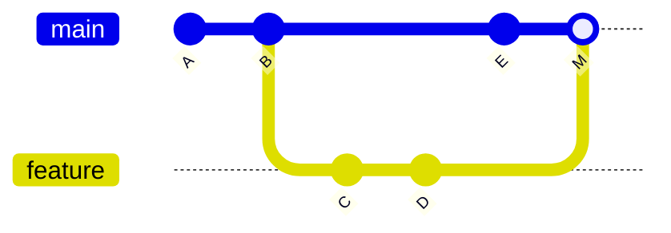

*Commit M is a merge commit. It has two parents: E (from `main`) and D (from `feature`).*

```bash
# Merge the feature branch into main
git switch main
git merge feature/login
```

#### Rebase and rewritten identities

A commit's ID is computed from its content, **including its parent**. When rebasing, each commit is replayed on a new base, so its parent changes, and therefore its ID changes.

**Figure 7: Rebase and rewritten commit identities**

```text
Before:
  A ── B ── E          (main)
        \
         C ── D        (feature)

After `git switch feature && git rebase main`:
  A ── B ── E          (main)
             \
              C' ── D' (feature)

C' and D' have the same changes as C and D but different commit IDs.
The original C and D still exist in the object database until garbage-collected.
```

```bash
# Replay feature commits on top of the latest main
git switch feature/login
git rebase main
```

> [!WARNING]
> **The golden rule of rebasing:** do not rebase commits that other people have already based work on. Rebasing rewrites history; collaborators holding the old commits will have diverging histories. If you must update a rebased branch you own on a remote, prefer `git push --force-with-lease`, which refuses to overwrite remote work you have not seen, over a plain `--force`.

### 5.3 `git reset` vs `git revert`

| | `git reset` | `git revert` |
|---|---|---|
| Method | Moves the branch pointer | Adds a new commit that reverses an earlier one |
| History | **Rewritten** (commits disappear from the branch) | **Preserved** |
| Safe on shared branches | **No** | **Yes** |
| Typical use | Undo local, unpushed work | Undo a change already published |

**Figure 8: Reset modes**

```text
Starting point:   A ── B ── C   (main, HEAD at C)

git reset --soft  B   →  branch at B   | index keeps C's changes  | files keep C's changes
git reset --mixed B   →  branch at B   | index matches B          | files keep C's changes
git reset --hard  B   →  branch at B   | index matches B          | files match B (C's changes discarded)
```

**Figure 9: Revert creates a new commit**

```text
Before:       A ── B ── C           (main)

git revert C

After:        A ── B ── C ── C'     (main)
                            └─ C' applies the inverse of C
```

```bash
# Undo commit C by creating a new commit that reverses it
git revert <commit-hash>

# Undo a merge commit (-m 1 selects the mainline parent)
git revert -m 1 <merge-commit-hash>
```

### 5.4 Other Comparisons

| Pair | Key difference | Example |
|---|---|---|
| `git restore` vs `git checkout` | `restore` only restores files; `checkout` also switches branches, which made it easy to misuse | `git restore README.md` discards unstaged edits to the file |
| `git switch` vs `git checkout` | `switch` is dedicated to branches | `git switch -c new-branch` |
| `git stash` vs `git commit` | A stash is temporary shelf storage; a commit is permanent project history | `git stash push -m "wip: login form"` |
| `git clone` vs `git init` | `clone` copies an existing repository and its history; `init` creates an empty one | `git clone <url>` vs `git init` |
| `git diff` vs `git log -p` | `diff` compares two states; `log -p` shows the patch introduced by each commit | `git diff main feature` vs `git log -p -3` |

```bash
# Discard unstaged changes in one file (cannot be undone)
git restore README.md

# Remove a file from the staging area but keep your edits
git restore --staged README.md

# Shelve uncommitted work, then bring it back
git stash push -m "wip: login form"
git stash list
git stash pop
```

---

## 6. Git Internals

This section explains how Git represents and manages repository data. The aim is to understand not only *which* commands to run but *what Git is doing underneath*.

### 6.1 The `.git` Directory

```text
.git/
├── HEAD            # Which branch or commit is checked out
├── config          # Repository-specific configuration
├── description     # Used by some tools (e.g., GitWeb)
├── hooks/          # Scripts that run on events such as pre-commit
├── index           # The staging area
├── info/           # Extra repository information (e.g., exclude)
├── logs/           # The reflog
├── objects/        # The object database (all content lives here)
└── refs/
    ├── heads/      # Local branches
    └── tags/       # Tags
```

> [!NOTE]
> Never edit files inside `.git` manually unless you understand the consequences. Use plumbing commands such as `git update-ref` instead.

### 6.2 The Four Object Types

Git is a content-addressable store. Everything is saved as an **object**, identified by a hash of its content.

| Object | Stores |
|---|---|
| **Blob** | The contents of a file (not its name) |
| **Tree** | A directory listing: names, modes, and references to blobs and other trees |
| **Commit** | A pointer to a tree, parent commit(s), author, committer, and message |
| **Tag** (annotated) | A pointer to another object, with tagger and message |

**Figure 10: Git object model**

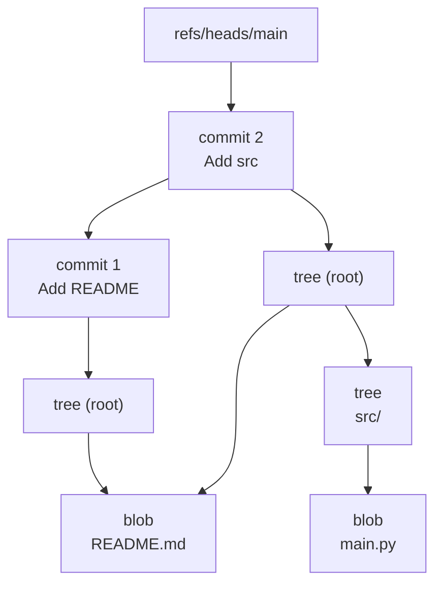

*Figure 10 shows two commits. Both root trees reference the same README blob, so Git stores that content only once.*

### 6.3 Object Identifiers and Hashing

An object's ID is the SHA-1 hash of a header (`<type> <size>\0`) followed by its content. (Newer Git versions also support SHA-256 repositories.)

```bash
# Compute the ID Git would assign to this content, without storing it
echo 'test content' | git hash-object --stdin
```

Expected output:

```text
d670460b4b4aece5915caf5c68d12f560a9fe3e4
```

You can reproduce the same hash manually to prove how it works:

```bash
# "test content\n" is 13 bytes, so the header is "blob 13" followed by a NUL byte
printf 'blob 13\0test content\n' | sha1sum
```

Because the ID derives from the content, identical content always gets the same ID, and any change to a commit (including its parent) produces a different ID. This is why rebasing changes commit identities.

### 6.4 References and HEAD

A **reference** (ref) is a human-readable name for an object ID. Branches and tags are refs.

**Figure 11: Reference chain: HEAD to commit**

```text
HEAD  ──►  refs/heads/main  ──►  commit 3f2a9c1
(symbolic ref)   (branch)             (object)
```

```bash
# See what HEAD points to
cat .git/HEAD

# List all references and their commit IDs
git show-ref

# Resolve a name to a full object ID
git rev-parse HEAD
```

Expected output:

```text
ref: refs/heads/main
```

When `HEAD` contains a commit ID instead of `ref: ...`, you are in **detached HEAD** state. Commits made there are not on any branch and can be lost unless you create a branch (`git switch -c <name>`).

### 6.5 Inspecting Objects

```bash
# Find the type of an object
git cat-file -t HEAD

# Print a commit object
git cat-file -p HEAD

# List the files in the commit's root tree
git ls-tree HEAD
```

Expected output (illustrative hashes):

```text
$ git cat-file -t HEAD
commit

$ git cat-file -p HEAD
tree 9f4d96d5b00d98959ea9960f069585ce42b1349a
author Your Name <you@example.com> 1700000000 +0000
committer Your Name <you@example.com> 1700000000 +0000

Add initial README

$ git ls-tree HEAD
100644 blob 8b1c2d3e4f5a6b7c8d9e0f1a2b3c4d5e6f7a8b9c	README.md
```

### 6.6 Loose Objects, Packfiles, and Garbage Collection

| Storage | Description |
|---|---|
| **Loose object** | A single compressed file under `.git/objects/xx/` |
| **Packfile** | Many objects stored together, with delta compression |
| **`git gc`** | Packs loose objects and removes unreachable objects after a grace period |

```bash
# Report object counts and disk usage
git count-objects -vH

# Verify the integrity of the object database
git fsck

# Optimize the repository
git gc
```

An object is **reachable** if some reference (branch, tag, reflog entry, stash) can lead to it. Unreachable objects are eventually deleted by garbage collection, which is why recovery is never guaranteed forever.

### 6.7 Plumbing vs Porcelain

| Layer | Purpose | Examples |
|---|---|---|
| **Porcelain** | User-friendly commands for everyday work | `git commit`, `git switch`, `git merge` |
| **Plumbing** | Low-level building blocks, stable for scripts | `git hash-object`, `git cat-file`, `git update-ref` |

Other advanced topics covered in the internals chapters: annotated tag objects, the index format, the reflog, shallow and partial clones, and Git bundles.

---

## 7. Troubleshooting

### 7.1 Required Troubleshooting Format

For each issue, document:

| Field | Description |
|---|---|
| Error message | The exact text |
| Environment and versions | OS, Git version, tool versions |
| What the error means | Plain-language explanation |
| Likely causes | Ranked possibilities |
| Diagnostic commands | Read-only commands to gather evidence |
| Confirmed root cause | Only when proven |
| Safe resolution | Step-by-step fix |
| Verification steps | How to confirm it worked |
| Prevention | How to avoid recurrence |
| Related documentation | Links |

> [!IMPORTANT]
> Do not present a suspected cause as a confirmed diagnosis.

### 7.2 Case 1: Commit on the Wrong Branch

**Problem:** A change was committed to `main` instead of a feature branch.

**Investigation (read-only):**

```bash
# Inspect recent commits
git log --oneline -5

# Inspect local branches
git branch

# Inspect the current working tree
git status

# Check whether the commit was already pushed
git log --oneline origin/main..main
```

**Decision table**

| Situation | Recommended approach |
|---|---|
| Commit **not pushed**, no uncommitted changes | Create a branch at the commit, then move `main` back |
| Commit **already pushed** to a shared branch | Use `git revert`, and cherry-pick onto the correct branch |
| Uncommitted changes in the working tree | Stash or commit them first |

**Resolution for an unpushed commit:**

```bash
# 1. Create a new branch pointing at the misplaced commit (keeps the work safe)
git branch feature/correct-branch

# 2. Move main back one commit (the work still exists on the new branch)
git reset --hard HEAD~1

# 3. Switch to the correct branch and confirm
git switch feature/correct-branch
git log --oneline -3
```

> [!WARNING]
> Step 2 uses `--hard`. Only run it when `git status` shows a clean working tree and the commit is safely referenced by the new branch (Step 1). If the commit was already pushed, do **not** reset a shared branch.

### 7.3 Case 2: Undoing a Mistaken Staging

```bash
# Unstage a file but keep the edits
git restore --staged <file>
```

### 7.3 Case 3: Recovering a Deleted Branch

The reflog records where `HEAD` and branches have pointed, which lets you find "lost" commits.

**Figure 12: Reflog-based recovery**

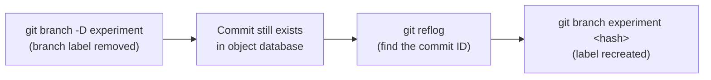

```bash
# Deleting a branch prints the commit it pointed to
git branch -D experiment
```

```text
Deleted branch experiment (was 4c5d6e7).
```

```bash
# If you missed that message, search the reflog
git reflog

# Recreate the branch at that commit
git branch experiment 4c5d6e7
```

> [!NOTE]
> Never assume that every deleted commit can be recovered. Recovery depends on object availability, garbage collection, repository maintenance, and backups. Unreachable objects are eventually removed.

### 7.4 Case 4: Resolving a Merge Conflict

A conflict occurs when two branches change the same lines (or one deletes a file the other modified) and Git cannot decide which version to keep.

**Figure 13: Merge conflict resolution workflow**

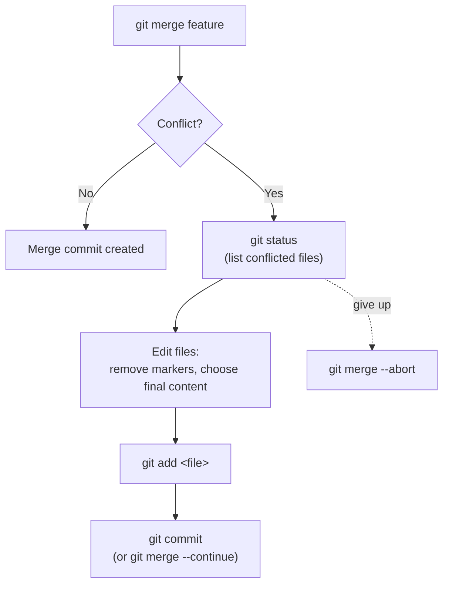

What a conflicted file looks like:

```text
<<<<<<< HEAD
print("Hello from main")
=======
print("Hello from feature")
>>>>>>> feature/greeting
```

| Marker | Meaning |
|---|---|
| `<<<<<<< HEAD` | Start of your current branch's version |
| `=======` | Separator |
| `>>>>>>> feature/greeting` | End of the incoming branch's version |

```bash
# See which files are in conflict
git status

# After editing the file to the final, correct content:
git add app.py
git commit
```

### 7.5 Case 5: Authentication Failures

| Symptom | Likely cause | Diagnostic |
|---|---|---|
| `Permission denied (publickey)` | SSH key missing, not loaded, or not registered with the host | `ssh -T git@github.com`, `ssh-add -l` |
| `Authentication failed` over HTTPS | Expired or incorrect token or password | `git remote -v`, check credential helper |
| `remote: Repository not found` | Wrong URL, or no access to a private repository | `git remote -v` |

```bash
# Check which URL and protocol the remote uses
git remote -v

# Test SSH authentication (GitHub example)
ssh -T git@github.com
```

> [!NOTE]
> Many hosting services no longer accept account passwords for Git over HTTPS and require a personal access token or SSH key. Check your provider's documentation.

### 7.6 Case 6: Finding the Commit That Broke Something

`git bisect` performs a binary search through history.

```bash
# Start bisecting
git bisect start

# Mark the current commit as broken
git bisect bad

# Mark a known-good earlier version
git bisect good v1.2.0

# Git checks out a middle commit. Test it, then tell Git the result:
git bisect good      # or: git bisect bad

# Repeat until Git reports the first bad commit, then return to normal
git bisect reset
```

For *n* commits between good and bad, bisect needs roughly log₂(*n*) steps. For example, 1,000 commits require about 10 tests.

---

## 8. Development Lessons Learned

This is a separate collection of development troubleshooting notes drawn from real project-building experiences. They relate to GitAtlas's broader goal of helping developers understand errors, dependency management, debugging, and safe recovery. **They are not all Git errors.**

> [!IMPORTANT]
> These records reflect previously encountered issues. Some resolutions were proposed but **not confirmed as successful**. Each record carries a status, and a fix is documented as successful only after it has been verified.

### 8.1 Summary of Cases

| # | Area | Project | Core lesson | Status |
|---|---|---|---|---|
| 1 | Expo and npm dependency conflict | Bhagavad Gita Android app | Align packages with the Expo SDK; check peer dependencies | Identified; fix not confirmed |
| 2 | React and React DOM mismatch | Bhagavad Gita Android app | Do not assume the latest of every package is compatible | Identified; fix not confirmed |
| 3 | Node.js engine compatibility | Bhagavad Gita Android app | Read engine requirements; separate warnings from errors | Documented |
| 4 | Missing Expo Router module | Bhagavad Gita Android app | Investigate the dependency tree before changing imports | Root cause not confirmed |
| 5 | Package mismatch after archive install | Bhagavad Gita Android app | Fix the original conflict first; secondary errors follow | Documented; fix not confirmed |
| 6 | Authentication route 404s | ContextIQ | Page routes and API routes are different things | Mismatch identified; flow not confirmed working |
| 7 | FastAPI root endpoint 404 | ContextIQ backend | A running server does not mean every URL exists | Cause indicated |
| 8 | Prisma `P1000` authentication failure | Bhagavad Gita Android app | Container networking differs from host networking | Observed; fix not confirmed |
| 9 | TypeScript seed data error | Bhagavad Gita Android app | Read the complete diagnostic; do not suppress with `any` | Final fix not established |

### 8.2 Case 1: Expo and npm Dependency Conflicts

**Project:** Bhagavad Gita Android app

**Reported error:**

```text
ERESOLVE unable to resolve dependency tree
```

**Reported conflict:**

```text
expo-router@6.0.24
expo-constants@~19.0.0
```

The Expo Router peer dependency required `expo-constants@^18.0.13`, so the declared versions did not satisfy it.

**Lessons learned**

- Align Expo packages with the project's Expo SDK.
- Check peer dependencies before installing packages.
- Use the official Expo version compatibility guidance.
- Avoid forcing incompatible dependencies merely to make installation succeed.

**Reference:** https://docs.expo.dev/

**Status:** The conflict was identified; a successful final resolution was not confirmed in the available history.

### 8.3 Case 2: React and React DOM Version Mismatch

**Project:** Bhagavad Gita Android app

**Reported versions:**

```text
react@19.1.0
react-dom@19.2.8
```

The reported React DOM dependency required `react@^19.2.8`, which conflicted with the installed React version.

**Lessons learned**

- Check the compatibility of React, React DOM, React Native, and the relevant framework before reinstalling dependencies.
- Do not assume that independently selecting the latest version of every package produces a compatible project.

**Status:** The conflict was identified; the final resolution was not confirmed.

### 8.4 Case 3: Node.js Engine Compatibility

**Project:** Bhagavad Gita Android app

Earlier development logs showed:

```text
Node.js: v20.17.0
npm: 10.8.2
```

Warnings indicated that some React Native and Metro packages required a newer Node.js version. A later session reported:

```text
Node.js: v22.23.2
```

**Lessons learned**

- Read engine requirements from package warnings.
- Check the project's supported Node.js range.
- Distinguish warnings from fatal errors.
- Verify the complete toolchain after changing Node.js versions.

**Reference:** https://nodejs.org/

### 8.5 Case 4: Missing Expo Router Module

**Project:** Bhagavad Gita Android app

**Reported error:**

```text
Error: Cannot find module 'expo-router/internal/routing'
```

This occurred during an Expo startup attempt. A package compatibility issue was suspected, but the available history does not establish a confirmed root cause.

**Investigation checklist:**

```bash
# Check the Node.js version
node --version

# Check the npm version
npm --version

# Inspect the installed Expo Router package
npm ls expo-router

# Inspect Expo package compatibility
npx expo install --check
```

**Lesson learned:** Investigate package compatibility and the installed dependency tree before changing imports or relying on undocumented internal modules.

**Status:** A final successful fix was not confirmed.

### 8.6 Case 5: Expo Package Mismatch After Installing a Project Archive

**Project:** Bhagavad Gita Android app

**Reported mismatch:**

```text
expo-router@57.0.17
expo-constants@~19.0.8
```

The reported Expo Router requirement was `expo-constants@^57.0.15`, which prevented the dependency tree from resolving. Later symptoms included:

```text
'tsc' is not recognized
```

and an Expo startup failure because Expo was not installed successfully.

**Lessons learned**

- A failed dependency installation can cause secondary errors. Fix the original package conflict first, then reinstall and verify the toolchain.
- A missing TypeScript executable is not proof that the TypeScript source code is incorrect.

**Figure: Error cascade**

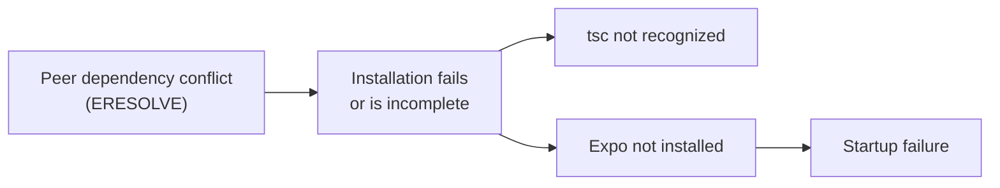

**Status:** The reported conflict was documented; a successful final fix was not confirmed.

### 8.7 Case 6: ContextIQ Authentication Route Errors

**Project:** ContextIQ, a Context-Aware AI Document Assistant

**Reported Next.js errors:**

```text
GET /api/auth/session 404
GET /login 404
GET /register 404
```

The earlier investigation found authentication pages under:

```text
/auth/login
/auth/register
/auth/forgot-password
/auth/reset-password
```

The application was requesting paths that did not match the existing page routes. The `/api/auth/session` request also indicated a missing or misaligned authentication API endpoint.

| Requested | Existing | Result |
|---|---|---|
| `/login` | `/auth/login` | 404 |
| `/register` | `/auth/register` | 404 |
| `/api/auth/session` | Not confirmed to exist | 404 |

**Investigation checklist**

- Inspect the existing App Router or Pages Router structure.
- Check links and redirects pointing to `/login` and `/register`.
- Verify the authentication library and its configured endpoints.
- Confirm whether `/api/auth/session` is supposed to exist.
- Check the browser's network panel and server logs.

**Lesson learned:** A page route and an API route are different things. Creating or renaming a page does not automatically implement the API endpoint used by an authentication library.

**Status:** The route mismatch was identified, but the final authentication flow was not confirmed as fully working.

### 8.8 Case 7: FastAPI Root Endpoint Returning 404

**Project:** ContextIQ backend

**Reported environment:** `http://127.0.0.1:8000`

The server started successfully, but requesting `/` returned:

```text
404 Not Found
```

The earlier investigation indicated that the backend did not define a root route.

**Lessons learned**

- A running server does not guarantee that every URL has a corresponding endpoint.
- Check the defined routes and API documentation before diagnosing a server startup failure.
- For FastAPI applications, inspect the configured routes and, when enabled, the interactive API documentation at `/docs`.

**Reference:** https://fastapi.tiangolo.com/

### 8.9 Case 8: Prisma Database Authentication Failure

**Project:** Bhagavad Gita Android app

**Reported environment:**

```text
Docker container: bhagavad-gita-postgres
PostgreSQL image: postgres:16
Database:         bhagavad_gita
Port:             5432
Prisma Client:    6.19.0
```

Database introspection and migration attempts reported error code `P1000`. The same history indicated that PostgreSQL could be accessed with `psql` through `docker exec`, while the local `psql` executable was not recognized.

**Figure: Container-local versus host-local access**

```text
┌───────────────────────────── Host machine ─────────────────────────────┐
│                                                                        │
│   Prisma (runs on host)  ──── localhost:5432 ────►  Docker port map    │
│   uses DATABASE_URL                                     │              │
│                                                         ▼              │
│                                        ┌─── Container ───────────┐     │
│   docker exec ... psql  ─────────────► │  PostgreSQL (postgres:16)│     │
│   (runs INSIDE container)              └──────────────────────────┘     │
└────────────────────────────────────────────────────────────────────────┘
Working access from inside the container does not prove that the
host-side credentials, hostname, and port in DATABASE_URL are correct.
```

**Lesson learned:** Successful database access inside a container does not prove that credentials, hostnames, ports, and connection settings are correct for a process running on the host.

**Investigate**

- Database credentials.
- `DATABASE_URL`.
- Hostname and port.
- Container port mappings.
- Database name.
- PostgreSQL user privileges.
- The distinction between container-local and host-local networking.

> [!WARNING]
> Do not publish real database credentials in logs or documentation.

**Status:** The authentication failure was observed, but the final successful Prisma connection was not confirmed.

### 8.10 Case 9: TypeScript Seed Data Type Error

**Project:** Bhagavad Gita Android app

A previous type-checking run reported:

```text
lib/content/seed.ts:12:14 - error TS2322
```

The diagnostic indicated that an object containing fields such as `id`, `bookId`, `chapterNumber`, and `titleSanskrit` was not assignable to the expected type. The available error excerpt was incomplete.

**Lessons learned**

- Read the complete TypeScript diagnostic.
- Compare the object with the declared interface or type.
- Check required properties, nullable fields, and inferred types.
- Fix the type mismatch rather than suppressing it with `any` or an unsafe assertion.

**Status:** The exact final fix was not established by the available record.

### 8.11 Recurring Engineering Principles

| # | Principle |
|---|---|
| 1 | Dependency errors can produce secondary startup failures |
| 2 | Runtime compatibility matters as much as package names |
| 3 | Frontend routes and backend endpoints must be aligned |
| 4 | A running server is not proof that the requested route exists |
| 5 | Container networking differs from host networking |
| 6 | TypeScript errors require examination of the complete type contract |
| 7 | A proposed fix should not be documented as successful until verified |

These records should be updated when a confirmed solution becomes available.

---

## 9. Security and Safe Recovery

GitAtlas prioritizes protecting source code, credentials, and development data.

### 9.1 Topics Covered

| Area | Topics |
|---|---|
| Secrets | Avoiding committed secrets, credential helpers |
| Authentication | SSH authentication, signed commits and tags |
| Access control | Repository permissions, protected branches |
| History safety | Force-push risks, history rewriting, safe recovery |
| Incident response | Handling compromised credentials |
| Supply chain | Third-party dependency risks |
| Integrity | Repository integrity checks (`git fsck`) |

### 9.2 Safety Rule: Inspect Before You Destroy

Before using commands that can discard changes or rewrite history, inspect the current repository state.

```bash
# Inspect uncommitted changes
git status

# Inspect recent history
git log --oneline -5

# Inspect recent reference movements
git reflog -10
```

**Risk levels of common commands**

| Command | Risk | Why |
|---|---|---|
| `git status`, `git log`, `git diff` | None | Read-only |
| `git add`, `git commit` | Low | Adds data, does not discard |
| `git stash` | Low | Shelves changes recoverably |
| `git revert` | Low | Adds a new commit |
| `git reset --mixed` | Medium | Moves history pointer; files kept |
| `git rebase` | Medium | Rewrites commit IDs |
| `git restore <file>` | **High** | Discards unstaged edits permanently |
| `git reset --hard` | **High** | Discards uncommitted work |
| `git clean -fd` | **High** | Deletes untracked files permanently |
| `git push --force` | **High** | Overwrites remote history |

> [!TIP]
> Preview before deleting: `git clean -nd` shows what `git clean -fd` would remove, without removing anything.

> [!IMPORTANT]
> Never promise that every deleted commit can be recovered. Recovery depends on object availability, repository maintenance, backups, and other circumstances.

### 9.3 Playbook A: A Secret Was Committed

If a password, API key, token, or private key has been committed, treat it as **compromised**, even if the commit was never pushed to a public location and even if you delete the file afterward.

**Response order matters:**

| Step | Action | Reason |
|---|---|---|
| 1 | **Revoke or rotate the credential immediately** | Removing it from Git does not un-expose it |
| 2 | Determine exposure: which commits, branches, and remotes contain it | Scope the incident |
| 3 | Remove it from history using a dedicated tool such as `git filter-repo` (a separate, third-party tool) | Deleting the file in a new commit leaves it in older commits |
| 4 | Force-push the rewritten history with `--force-with-lease` and coordinate with collaborators | Others must re-clone or reset |
| 5 | Check forks, open pull requests, CI logs, and caches | Copies may exist outside the main repository |
| 6 | Add the file pattern to `.gitignore` and enable secret scanning or pre-commit checks | Prevent recurrence |

```bash
# Detect staged secrets before committing (example habit)
git diff --staged

# Stop tracking a file but keep it on disk
git rm --cached .env
echo ".env" >> .gitignore
git commit -m "Stop tracking .env"
```

> [!WARNING]
> Step 3 rewrites history and affects everyone who has cloned the repository. Rotating the credential (Step 1) is the part that actually restores security.

### 9.4 Safe Force Pushing

```bash
# Dangerous: overwrites the remote branch unconditionally
git push --force

# Safer: fails if someone else pushed commits you have not fetched
git push --force-with-lease
```

Protect important branches (such as `main`) with branch protection rules so force pushes and direct pushes are blocked.

---

## 10. Research and Publications

GitAtlas will include a research library covering version control, software configuration management, repository mining, software evolution, merge conflicts, collaboration, and software supply-chain security.

### 10.1 Research Sources

| Source | URL |
|---|---|
| ACM Digital Library | https://dl.acm.org/ |
| IEEE Xplore | https://ieeexplore.ieee.org/ |
| USENIX Publications | https://www.usenix.org/publications |
| Google Scholar | https://scholar.google.com/ |
| DBLP | https://dblp.org/ |
| Crossref | https://search.crossref.org/ |

### 10.2 Publication Record Template

Each research entry should use this format.

| Field | Entry |
|---|---|
| Publication title | |
| All listed authors | |
| Publication year | |
| Journal or conference | |
| DOI (if available) | |
| Official publication link | |
| Legitimate open-access link (if available) | |
| Research question | |
| Methodology | |
| Main findings | |
| Limitations | |
| Relevance to Git or version control | |

### 10.3 Verification Rules

- Do not invent references or summarize papers that have not been examined.
- Confirm the DOI resolves and that the title, authors, and year match the publisher's record.
- Distinguish academic papers from blog posts, official documentation, books, and historical sources.
- Record the date each reference was last verified.

> [!NOTE]
> The research library is intentionally empty until entries have been individually verified.

---

## 11. Git History and Contributors

GitAtlas documents Git's development and the people responsible for its evolution.

### 11.1 Topics Covered

- Git's origins in 2005.
- Linus Torvalds and Git's initial development.
- Junio C Hamano and Git maintenance.
- Major milestones in Git's history.
- The development of important commands.
- Documentation contributors.
- Authors of referenced books and papers.
- Historical changes in Git's architecture.

### 11.2 Timeline (Summary)

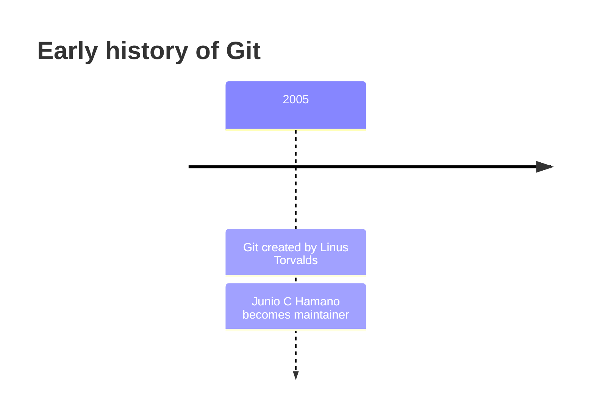

> [!NOTE]
> This timeline is a summary placeholder. Each entry in `history/git-timeline.md` must be verified against official project records, mailing-list archives, and the commit history in the [Git source repository](https://github.com/git/git) before publication.

### 11.3 Contributor Attribution Policy

Contributor records must be based on verifiable sources, such as official project records, commit history, publication records, and documented maintainer roles.

| Role | Meaning |
|---|---|
| Author | Wrote the original change |
| Committer | Applied the change to the repository |
| Maintainer | Responsible for a project or area |
| Release manager | Prepares and publishes releases |
| Documentation contributor | Wrote or improved documentation |

The project aims to build a comprehensive index, without claiming that a static list will permanently include every contributor.

---

## 12. Practical Exercises

Exercises are organized by difficulty. Each exercise includes starting conditions, expected outcomes, verification steps, and a solution.

### 12.1 Exercise Index

| Level | Exercises |
|---|---|
| **Beginner** | Initialize a repository; stage selected files; create commits; inspect history; configure `.gitignore`; create and switch branches |
| **Intermediate** | Resolve a merge conflict; rebase a feature branch; revert a commit; stash and restore changes; work with remotes; investigate a regression with `git bisect` |
| **Advanced** | Recover a branch using the reflog; inspect Git objects; investigate repository integrity; work with multiple worktrees; diagnose an incorrect remote configuration; safely repair a mistaken history change |

### 12.2 Exercise B1 (Beginner): Selective Staging

**Starting conditions**

```bash
mkdir staging-lab && cd staging-lab
git init -b main
echo "app code" > app.py
echo "notes" > notes.txt
```

**Task:** Commit only `app.py`, leaving `notes.txt` untracked.

**Expected outcome:** The history contains one commit with `app.py`; `git status` still lists `notes.txt` as untracked.

**Verification**

```bash
git log --oneline
git status --short
```

<details>
<summary><strong>Solution</strong></summary>

```bash
# Stage only the file you want in the commit
git add app.py

# Confirm exactly what will be committed
git status

# Commit
git commit -m "Add app code"
```

Expected `git status --short` afterward:

```text
?? notes.txt
```

**Explanation:** `git add` stages only the paths you name. Using `git add .` would have staged both files.

</details>

### 12.3 Exercise I1 (Intermediate): Resolve a Merge Conflict

**Starting conditions**

```bash
mkdir conflict-lab && cd conflict-lab
git init -b main
echo 'print("Hello")' > app.py
git add app.py
git commit -m "Add app"

git switch -c feature/greeting
echo 'print("Hello from feature")' > app.py
git commit -am "Change greeting on feature"

git switch main
echo 'print("Hello from main")' > app.py
git commit -am "Change greeting on main"
```

**Task:** Merge `feature/greeting` into `main` so that the final file prints `Hello from main and feature`.

**Expected outcome:** A merge commit exists, and `app.py` contains the combined greeting with no conflict markers.

**Verification**

```bash
cat app.py
git log --oneline --graph
grep -n "<<<<<<<" app.py   # should print nothing
```

<details>
<summary><strong>Solution</strong></summary>

```bash
# Start the merge. Git reports a conflict in app.py
git merge feature/greeting

# Edit app.py so it contains only:
#   print("Hello from main and feature")

# Mark the conflict as resolved
git add app.py

# Complete the merge
git commit
```

**Explanation:** Both branches changed the same line after the common ancestor, so Git could not choose automatically. You decide the final content, stage the file to mark it resolved, and commit.

</details>

### 12.4 Exercise A1 (Advanced): Recover a Deleted Branch

**Starting conditions**

```bash
mkdir recovery-lab && cd recovery-lab
git init -b main
echo one > a.txt
git add a.txt
git commit -m "Initial commit"

git switch -c experiment
echo two > b.txt
git add b.txt
git commit -m "Work on experiment"

git switch main
git branch -D experiment
```

**Task:** Restore the `experiment` branch with its commit.

**Expected outcome:** `git branch` lists `experiment`, and `git log experiment --oneline` shows "Work on experiment".

**Verification**

```bash
git branch
git log experiment --oneline
```

<details>
<summary><strong>Solution</strong></summary>

```bash
# Option 1: use the hash printed by `git branch -D`, shown as:
#   Deleted branch experiment (was <hash>).
git branch experiment <hash>

# Option 2: find the commit in the reflog
git reflog
git branch experiment <hash-of-"Work on experiment">
```

**Explanation:** Deleting a branch removes only the label. The commit remains in the object database, and the reflog still records it, until garbage collection eventually removes unreachable objects.

</details>

---

## 13. Documentation Standards

Every page must meet these standards before being considered complete.

| # | Requirement | Done when |
|---|---|---|
| 1 | Clear title and scope | The first paragraph states what the page covers |
| 2 | Accurate terminology | Terms match the official Git documentation |
| 3 | Valid command syntax | Commands have been run successfully |
| 4 | Tested examples | Examples were executed where practical |
| 5 | Explanations of important options | Every flag shown is explained |
| 6 | Expected results | Output is shown or described |
| 7 | Relevant diagrams | Visuals accompany complex concepts |
| 8 | Troubleshooting guidance | Common errors are listed |
| 9 | Security warnings | Present when a command is destructive or sensitive |
| 10 | Version notes | Behavior differences between Git releases are noted |
| 11 | Reliable references | Claims link to supporting sources |
| 12 | Links to related topics | Readers can navigate onward |

> [!IMPORTANT]
> Commands that modify repository history or discard data require explicit explanations of their consequences. Research entries must use verified bibliographic information.

---

## 14. Project Structure

The repository is organized into focused sections.

```text
GitAtlas/
├── README.md
├── LICENSE
├── CONTRIBUTING.md
├── CODE_OF_CONDUCT.md
├── SECURITY.md
├── SUPPORT.md
├── AUTHORS.md
├── CHANGELOG.md
├── CITATION.cff
│
├── docs/
│   ├── fundamentals/
│   ├── installation/
│   ├── configuration/
│   ├── working-with-files/
│   ├── staging-and-commits/
│   ├── branching/
│   ├── merging-and-rebasing/
│   ├── remote-repositories/
│   ├── advanced-workflows/
│   ├── repository-internals/
│   ├── security/
│   ├── performance/
│   └── collaboration/
│
├── commands/
│   ├── git-init.md
│   ├── git-clone.md
│   ├── git-status.md
│   ├── git-add.md
│   ├── git-commit.md
│   ├── git-log.md
│   ├── git-diff.md
│   ├── git-branch.md
│   ├── git-switch.md
│   ├── git-merge.md
│   ├── git-rebase.md
│   ├── git-reset.md
│   ├── git-restore.md
│   ├── git-revert.md
│   ├── git-stash.md
│   ├── git-fetch.md
│   ├── git-pull.md
│   ├── git-push.md
│   ├── git-reflog.md
│   └── README.md
│
├── comparisons/
│   ├── fetch-vs-pull.md
│   ├── merge-vs-rebase.md
│   ├── reset-vs-revert.md
│   ├── restore-vs-checkout.md
│   └── README.md
│
├── diagrams/
│   ├── mermaid/
│   └── svg/
│
├── examples/
│   ├── beginner/
│   ├── intermediate/
│   └── advanced/
│
├── troubleshooting/
│   ├── common-errors.md
│   ├── lost-commits.md
│   ├── merge-conflicts.md
│   ├── authentication.md
│   ├── accidental-changes.md
│   └── README.md
│
├── developer-lessons/
│   ├── dependency-conflicts.md
│   ├── node-version-errors.md
│   ├── routing-and-api-errors.md
│   ├── database-connection-errors.md
│   ├── typescript-errors.md
│   └── README.md
│
├── research/
│   ├── README.md
│   ├── papers/
│   ├── journals/
│   ├── conferences/
│   ├── books/
│   └── bibliography.bib
│
├── history/
│   ├── git-timeline.md
│   ├── creators-and-maintainers.md
│   └── contributors.md
│
├── exercises/
│   ├── beginner/
│   ├── intermediate/
│   └── advanced/
│
├── glossary/
│   └── README.md
│
├── resources/
│   ├── official-documentation.md
│   └── further-reading.md
│
└── .github/
    ├── ISSUE_TEMPLATE/
    ├── PULL_REQUEST_TEMPLATE.md
    └── workflows/
```

> [!NOTE]
> This is the proposed structure. Additional files should be created as their content is implemented and reviewed.

---

## 15. Technology and Tools

GitAtlas is primarily a Markdown-based documentation project.

| Tool | Purpose |
|---|---|
| Git | Version control |
| GitHub | Source hosting and collaboration |
| Markdown | Documentation |
| Mermaid | Version-controlled diagrams |
| GitHub Actions | Automated validation |
| Markdown linting | Consistent documentation formatting |
| Link checking | Identifying broken references |
| Docusaurus or VitePress | Potential documentation website |
| BibTeX | Structured research references |

The initial project does not require a backend or database. A website can be introduced later without making the Markdown documentation dependent on it.

---

## 16. Getting Started and Contributing

### 16.1 Prerequisites

- Git installed on your computer.
- A Markdown editor.
- A GitHub account if you intend to contribute through GitHub.

### 16.2 Contribution Workflow

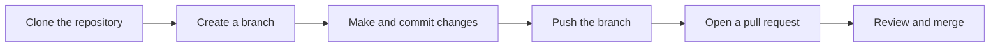

**Step 1. Clone the repository** (after it has been created and published)

```bash
# Clone the repository
git clone https://github.com/YOUR_USERNAME/GitAtlas.git

# Enter the project directory
cd GitAtlas

# Inspect the repository
git status
```

Replace `YOUR_USERNAME` with the actual GitHub username.

**Step 2. Create a branch for your contribution**

```bash
# Create and switch to a documentation branch
git switch -c docs/first-contribution
```

**Step 3. Make and commit a change**

```bash
# Stage the documentation changes
git add README.md

# Commit the changes
git commit -m "Improve GitAtlas documentation"

# Inspect the new commit
git log --oneline -3
```

**Step 4. Publish your branch**

```bash
git push -u origin docs/first-contribution
```

After pushing, open a pull request through the repository hosting interface. These instructions assume that the repository has been cloned from a remote and that you have permission to push your branch.

### 16.3 Types of Contribution

Contributions are welcome from developers, testers, students, technical writers, and researchers.

- Fixing incorrect explanations.
- Adding tested command examples.
- Improving diagrams.
- Documenting errors and recovery procedures.
- Adding verified research references.
- Improving accessibility.
- Correcting broken links.
- Updating version-specific behavior.
- Translating documentation.
- Reviewing proposed changes.

### 16.4 Pre-Submission Checklist

- [ ] Check whether the topic already exists.
- [ ] Use the established documentation structure.
- [ ] Verify command syntax against the relevant Git version.
- [ ] Test examples where practical.
- [ ] Explain destructive operations.
- [ ] Verify external references.
- [ ] Avoid copying copyrighted material without permission.
- [ ] Clearly identify any unverified assumptions.

See `CONTRIBUTING.md` for the complete contribution policy once it has been created.

---

## 17. Roadmap

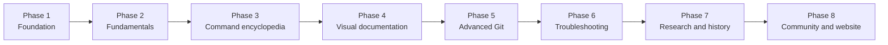

### Phase 1: Foundation

- [x] Define the project vision.
- [x] Design the documentation architecture.
- [x] Identify initial troubleshooting topics.
- [ ] Publish the initial repository.
- [ ] Add the project license.
- [ ] Establish contribution guidelines.

### Phase 2: Git Fundamentals

- [ ] Installation and configuration.
- [ ] Repository basics.
- [ ] Working tree and staging area.
- [ ] Commits and history.
- [ ] Branches and tags.

### Phase 3: Command Encyclopedia

- [ ] Establish the complete command inventory.
- [ ] Document every command category.
- [ ] Explain important options.
- [ ] Add tested examples.
- [ ] Cross-reference related commands.

### Phase 4: Visual Documentation

- [ ] Commit graph diagrams.
- [ ] Branching and merging diagrams.
- [ ] Rebase comparisons.
- [ ] Git object model.
- [ ] Recovery workflows.

### Phase 5: Advanced Git

- [ ] Git internals.
- [ ] Advanced branching workflows.
- [ ] Repository maintenance.
- [ ] Performance.
- [ ] Security.

### Phase 6: Troubleshooting

- [ ] Common Git errors.
- [ ] Lost commits and branches.
- [ ] Authentication problems.
- [ ] Merge conflicts.
- [ ] Safe recovery procedures.
- [ ] Developer troubleshooting lessons.

### Phase 7: Research and History

- [ ] Verified research bibliography.
- [ ] Relevant journals and conferences.
- [ ] Books and technical publications.
- [ ] Git history.
- [ ] Contributor references.

### Phase 8: Community and Website

- [ ] Automated documentation checks.
- [ ] Contribution templates.
- [ ] Searchable documentation website.
- [ ] Interactive learning resources.
- [ ] Community-reviewed improvements.

> [!NOTE]
> Roadmap checkboxes indicate project planning status, not that the corresponding documentation has already been completed.

---

## 18. License

The project license must be selected and added to the repository before GitAtlas is distributed under a declared license.

The license should clearly distinguish original GitAtlas material from third-party content, which remains subject to its own applicable terms.

Third-party documentation, figures, quotations, and datasets must not be incorporated without checking the applicable copyright and licensing requirements.

---

## 19. References

### 19.1 Official Git Resources

| Resource | URL |
|---|---|
| Git website | https://git-scm.com/ |
| Git reference manual | https://git-scm.com/docs |
| Pro Git book | https://git-scm.com/book/en/v2 |
| Git source repository | https://github.com/git/git |

### 19.2 Related Development Resources

| Resource | URL |
|---|---|
| Expo documentation | https://docs.expo.dev/ |
| Node.js documentation | https://nodejs.org/docs/ |
| FastAPI documentation | https://fastapi.tiangolo.com/ |
| Prisma documentation | https://www.prisma.io/docs |
| TypeScript documentation | https://www.typescriptlang.org/docs/ |

These resources support the documentation and troubleshooting sections. Individual pages should link to the specific reference that supports their claims.

---

## Appendix A: Quick Reference

### A.1 Daily Workflow

```bash
git status                       # What changed?
git switch -c feature/name       # Start a branch
git add <file>                   # Stage a file
git commit -m "Message"          # Record a commit
git fetch origin                 # Download remote updates
git merge origin/main            # Integrate them
git push -u origin feature/name  # Publish the branch
```

### A.2 "I Made a Mistake" Cheat Sheet

| Situation | Command | Risk |
|---|---|---|
| Staged the wrong file | `git restore --staged <file>` | Low |
| Want to discard edits to a file | `git restore <file>` | **High** |
| Typo in the last commit message (not pushed) | `git commit --amend` | Medium |
| Undo last commit, keep changes | `git reset --soft HEAD~1` | Low |
| Undo a pushed commit | `git revert <hash>` | Low |
| Deleted a branch by accident | `git reflog`, then `git branch <name> <hash>` | Low |
| Need to switch branches with unfinished work | `git stash push -m "wip"` | Low |
| Committed on the wrong branch | See [7.2](#72-case-1-commit-on-the-wrong-branch) | Medium |
| Committed a secret | See [9.3](#93-playbook-a-secret-was-committed) | **High** |

### A.3 Useful Inspection Commands

```bash
git log --oneline --graph --decorate --all   # Whole history as a graph
git show <commit>                            # One commit in detail
git blame <file>                             # Who changed each line
git diff --staged                            # What is staged
git reflog                                   # Where HEAD has been
git fsck                                     # Verify repository integrity
```

---

## Appendix B: Glossary

| Term | Definition |
|---|---|
| **Blob** | An object that stores the contents of a file |
| **Branch** | A movable pointer to a commit |
| **Commit** | A snapshot of the project with metadata and parent reference(s) |
| **Detached HEAD** | A state where HEAD points directly at a commit rather than a branch |
| **Fast-forward** | A merge that only moves a branch pointer forward |
| **Fetch** | Download remote objects and update remote-tracking branches |
| **HEAD** | A pointer to the current checkout, usually a branch |
| **Index** | The staging area; the proposed next commit |
| **Merge conflict** | Overlapping changes that Git cannot combine automatically |
| **Origin** | The default name for the remote a repository was cloned from |
| **Packfile** | A compressed bundle of many objects |
| **Rebase** | Reapplying commits on a new base, creating new commits |
| **Reflog** | A local log of where references have pointed |
| **Reference (ref)** | A name pointing to an object ID, such as a branch or tag |
| **Remote** | A named connection to another repository |
| **Remote-tracking branch** | A local, read-only record of a remote branch, such as `origin/main` |
| **Repository** | The `.git` database of objects and references |
| **Stash** | A temporary shelf for uncommitted changes |
| **Tag** | A named reference to a specific commit, often a release |
| **Tree** | An object representing a directory |
| **Upstream** | The remote branch that a local branch tracks |
| **Working tree** | The files you edit, checked out from the repository |

---

## Final Note

GitAtlas is intended to grow into a reliable, community-maintained Git knowledge base. The priority is to make each explanation accurate, useful, reproducible, and easy to understand.

**Understand the command. Understand the history. Understand the consequences.**

**GitAtlas: Git knowledge, organized for everyone.**


---

<p align="center">  <a href="https://github.com/Devputta/Drafts-might-be-needed-/blob/main/LOGO/Gemini_Generated_Image_1ppnm1ppnm1ppnm1%20(1).jfif" target="_blank" rel="noopener noreferrer">      </a></p>
<p align="center">
  <strong>GIT Documentry</strong><br />
  Private by design. Static by choice.
</p>
